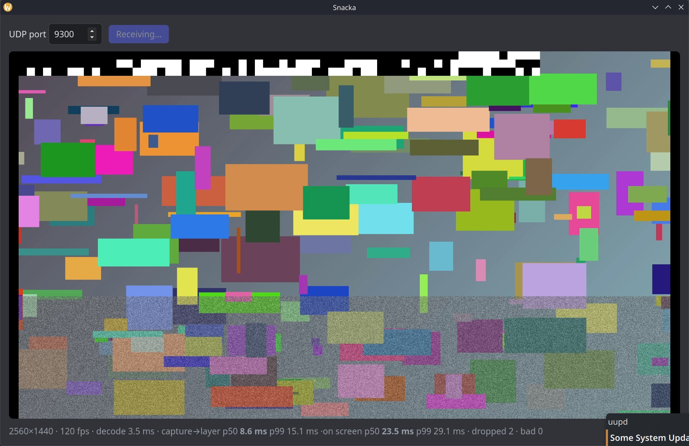

# Linux results: Ryzen AI Max+ 395 + Radeon 8060S (Strix Halo)

**Machine:** ASUS ROG Flow Z13 (GZ302EA), AMD Ryzen AI Max+ 395, 128 GB unified memory, Radeon 8060S iGPU (RDNA 3.5,
VCN 4). Display: built-in 2560×1600 @ 180 Hz, 150 % scaling. On AC power, platform profile `performance`.
**OS:** Bazzite 44 (Fedora 44 atomic, `bazzite-dx`), kernel 7.2.1-ogc4.1, KDE Plasma / KWin 6.7.4 on **Wayland**
(Plasma 6.7 ships no X11 session, so "X11" below means the same app on **XWayland**, `GDK_BACKEND=x11`).
**Built and run in a Fedora 44 distrobox:** WebKitGTK 2.54.2 (GTK 3.24.52), Mesa 26.2.7 with RPM Fusion's
`mesa-va-drivers-freeworld` (Fedora's own build has no H.264/HEVC), FFmpeg 8.1.3, libva 1.23, Chromium 158, Rust 1.100.

## Summary

1. **WebKitGTK is smooth enough, and passes every criterion, but only at 60 fps.** Scrolling 10k messages runs at a
   steady 60 fps with no hitches, mount is 30–40 ms and typing→frame is 17 ms p95, on Wayland and XWayland, with every
   workaround variable. Chromium on the same machine renders the same UI at the display's 180 Hz (5.6 ms typing→frame).
   It's the same situation as WKWebView on macOS: fine for chat, but not "high refresh". Idle CPU is negligible
   (0.05 % of a core, vs 1 % for Chromium). **Verdict: good enough to ship on Linux; no Chromium fallback needed for
   smoothness.** The 60 fps cap is a WebKitGTK limitation we can track upstream (section 1.2).
2. **VAAPI on the iGPU handles every tier up to 4K120** (H.264/HEVC): capture → decoded **5.5–8 ms at 1080p/1440p120**
   and **12–13.5 ms at 4K120** in loopback, with zero corrupt frames. About 2–3× the RTX 4090's latency; at 4K120 the
   encoder (7.5–8 ms) is right at the 8.3 ms frame budget.
3. **The native video surface works in the Tauri window on Wayland:** a `wl_subsurface` showing the decoder's VA
   surfaces as zero-copy DMA-BUF buffers. 1440p120 HEVC: capture → committed **8.6–9 ms p50**, capture → **on screen
   18.9–23.5 ms p50** (measured with `wp_presentation`, which Windows/macOS didn't measure), placed exactly over the
   UI's box when windowed, maximised, fullscreen and resized, at 150 % scaling.
4. **AV1 encode from this pipeline hangs the video engine** (VCN ring timeout, reset by the kernel) at 1080p60, 1440p
   and 4K on Mesa 26.2.7. Plain `ffmpeg` with the same settings doesn't. AV1 *decode* works. Use HEVC on AMD for now.

## 1. UI benchmark (#51)

10k messages, `client/ui/src/Bench.tsx`, window 1280×800. Tauri debug build (`pnpm tauri build --debug --no-bundle`)
and Chromium 158 on the production build (`pnpm --dir ui preview`, `--app=…/#bench`). Three runs each; the first
run is a cold start.

| Runtime | Session | DPR | Mount (cold / warm) | Scroll fps (p99) | Append fps | Typing→frame p50 / p95 | Hitches >25 ms |
|---|---|---|---|---|---|---|---|
| WebKitGTK 2.54 (Tauri), default | Wayland | 2 | 31 / 31–34 ms | 60 (18 ms) | 60 | 17 / 18 ms | 0 |
| … `WEBKIT_DISABLE_DMABUF_RENDERER=1` | Wayland | 2 | 34 / 34–38 ms | 62 (17 ms) | **91** | **11 / 13 ms** | 0 |
| … `WEBKIT_DISABLE_COMPOSITING_MODE=1` | Wayland | 2 | 40 / 36–40 ms | 60 (18 ms) | 60 | 17 / 17 ms | 0 |
| … 60 fps preference off (see 1.2) | Wayland | 2 | 31 / 29–33 ms | 60 (18 ms) | 60 | 17 / 18 ms | 0 |
| WebKitGTK 2.54 (Tauri), default | XWayland | 1 | 30 / 32–43 ms | 60 (18 ms) | 60 | 17 / 18 ms | 0 |
| … `WEBKIT_DISABLE_DMABUF_RENDERER=1` | XWayland | 1 | 34 / 31–32 ms | 60 (18 ms) | 60 | 17 / 18 ms | 0 |
| … `WEBKIT_DISABLE_COMPOSITING_MODE=1` | XWayland | 1 | 39 / 33–40 ms | 60 (18 ms) | 60 | 17 / 18 ms | 0 |
| … 60 fps preference off | XWayland | 1 | 32 / 33–35 ms | 60 (18 ms) | 60 | 17 / 18 ms | 0 |
| Chromium 158 | Wayland | 1.5 | 48 / 40–43 ms | **180** (5.7 ms) | 180 | 5.6 / 5.7 ms | 0 |
| Chromium 158 | X11 (XWayland) | 1 | 58 / 42–49 ms | **180** (5.8–6.5 ms) | 180 | 5.6 / 6.5 ms | 0 |

**Pass** on every criterion for every variant (scroll ≥ 55 fps, ≤ 5 hitches, mount < 100 ms, typing p95 < 34 ms).
Idle CPU with the 10k-message list mounted, over 60 s, all processes of the app: **0.05 % of one core** for Tauri
(UI + WebKit web/network processes), **1.0 %** for Chromium (15 processes).

### 1.1 Observations
- **No variant beats 60 fps scrolling.** Disabling the DMA-BUF renderer makes appends (91 fps) and typing (11 ms) faster
  but not scrolling; the NVIDIA-oriented workaround variables aren't needed on AMD.
- **Fractional scaling:** WebKitGTK (GTK 3) renders at 2× and KWin scales down to 1.5×; Chromium uses the
  fractional-scale protocol and renders at 1.5×. Text looked fine in screenshots, but a human should compare
  sharpness side by side. On XWayland the app gets scale 1 (KWin's legacy-app scaling).
- XWayland and Wayland perform the same.

### 1.2 Why WebKitGTK stops at 60 fps (partly explained)
- WebKitGTK 2.54.2 drives rendering from a DRM vblank monitor. It finds the display's CRTC by **matching the monitor's
  physical size in mm**: GDK reports 288×180 mm, the kernel connector says 290×180 mm, so no match, and WebKit falls back
  to a **60 Hz timer** (journal: *"Could not create a vblank monitor … no drm node with CRTC found"*). WebKit `main`
  now matches by connector name (`eDP-1`), which would work here.
- WebKit also has a feature `PreferPageRenderingUpdatesNear60FPS` (default on), possibly also what caps WKWebView
  on macOS. The app can turn it off (`SNACKA_WEBKIT_FULL_RATE=1`, `src-tauri/src/webkit_linux.rs`).
- **Fixing both still gives 60 fps** (vblank match forced with an `LD_PRELOAD` shim + preference off), so a third
  60 Hz limit remains, which I didn't find (#64). None of this blocks shipping.

## 2. Encode → UDP → decode matrix (loopback, #49)

`examples/send.rs` → wire format → `examples/recv.rs`, both on this machine (shared CLOCK_MONOTONIC).
- **Source** (`stream/linux/source.rs`): synthetic BGRX texture on the GPU, scrolled; per frame one VAAPI
  video-processing picture blits the window and the barcode strip into an NV12 surface (BT.709 limited range). Only the
  barcode strip (≤ 2048×96) is uploaded from the CPU.
- **Encoder** (`encode.rs`): libavcodec `h264_vaapi` / `hevc_vaapi`, no B-frames, infinite GOP with IDR on request, CBR
  with a one-frame VBV, `async_depth=1` (one frame in flight). "speed" = Mesa's default preset (quality level 0),
  "balanced" = quality level 3.
- **Decoder** (`decode.rs`): libavcodec's `h264`/`hevc`/`av1` with a VAAPI device, `LOW_DELAY`, one thread; the
  picture's VA surface is synced before "decoded" is stamped.

Run with `python client/crates/snacka-core/run-matrix.py --seconds 8 --codecs h264,hevc --presets 0,3` (in the
distrobox). Columns as in the Windows table.

| Mode | Codec | Preset | fps sent / decoded | Encode p50/p99 ms | Decode p50/p99 ms | **Total p50**/p95/p99 ms | Mbps | Keyframes / requests | Dropped | Bad barcode |
|---|---|---|---|---|---|---|---|---|---|---|
| 1920x1080@60 | h264 | speed | 60 / 60 | 4.9 / 5.5 | 2.1 / 3.1 | **7.0** / 7.7 / 8.5 | 20 | 1 / 0 | 0 | 0 |
| 1920x1080@60 | h264 | balanced | 60 / 60 | 4.7 / 5.5 | 2.0 / 2.9 | **6.8** / 7.2 / 8.4 | 20 | 1 / 0 | 0 | 0 |
| 1920x1080@60 | hevc | speed | 60 / 60 | 4.4 / 4.9 | 2.4 / 4.3 | **6.9** / 7.4 / 9.7 | 20 | 1 / 0 | 0 | 0 |
| 1920x1080@60 | hevc | balanced | 60 / 60 | 4.5 / 5.2 | 2.4 / 4.3 | **7.1** / 7.8 / 9.7 | 20 | 1 / 0 | 0 | 0 |
| 1920x1080@120 | h264 | speed | 120 / 120 | 3.8 / 8.9 | 1.6 / 8.0 | **5.5** / 10.0 / 14.7 | 30 | 1 / 0 | 0 | 0 |
| 1920x1080@120 | h264 | balanced | 120 / 120 | 3.7 / 9.3 | 1.6 / 8.6 | **5.4** / 10.1 / 15.0 | 30 | 1 / 0 | 0 | 0 |
| 1920x1080@120 | hevc | speed | 120 / 120 | 3.9 / 12.7 | 2.1 / 11.8 | **6.6** / 14.7 / 23.8 | 30 | 1 / 0 | 0 | 0 |
| 1920x1080@120 | hevc | balanced | 120 / 120 | 4.0 / 8.7 | 2.2 / 9.4 | **6.4** / 13.1 / 16.6 | 30 | 1 / 0 | 0 | 0 |
| 1920x1080@120 | av1 | speed | 120 / 120 | 3.8 / 10.5 | 2.2 / 10.0 | **6.2** / 12.5 / 16.6 | 30 | 1 / 0 | 0 | 0 |
| 2560x1440@120 | h264 | speed | 120 / 120 | 5.2 / 16.2 | 2.4 / 12.3 | **8.0** / 16.1 / 25.4 | 50 | 1 / 0 | 0 | 0 |
| 2560x1440@120 | h264 | balanced | 120 / 120 | 5.0 / 13.0 | 2.2 / 10.6 | **7.5** / 13.2 / 17.8 | 50 | 1 / 0 | 0 | 0 |
| 2560x1440@120 | hevc | speed | 120 / 120 | 4.7 / 12.1 | 2.8 / 11.1 | **8.0** / 14.7 / 19.0 | 50 | 1 / 0 | 0 | 0 |
| 2560x1440@120 | hevc | balanced | 120 / 120 | 4.5 / 7.7 | 2.7 / 7.4 | **7.5** / 10.6 / 14.0 | 50 | 1 / 0 | 0 | 0 |
| 3840x2160@60 | h264 | speed | 60 / 60 | 7.5 / 18.5 | 5.2 / 6.4 | **13.2** / 19.4 / 39.3 | 60 | 1 / 0 | 0 | 0 |
| 3840x2160@60 | h264 | balanced | 60 / 60 | 7.4 / 10.9 | 5.2 / 6.5 | **13.0** / 15.2 / 21.7 | 60 | 1 / 0 | 0 | 0 |
| 3840x2160@60 | hevc | speed | 60 / 60 | 7.0 / 13.8 | 7.7 / 8.2 | **15.0** / 17.9 / 31.4 | 60 | 1 / 0 | 0 | 0 |
| 3840x2160@60 | hevc | balanced | 60 / 60 | 7.0 / 12.6 | 7.7 / 7.9 | **14.9** / 17.1 / 28.2 | 60 | 1 / 0 | 0 | 0 |
| 3840x2160@120 | h264 | speed | 117 / 117 | 7.6 / 14.9 | 3.2 / 11.0 | **12.1** / 17.7 / 22.0 | 97 | 1 / 0 | 0 | 0 |
| 3840x2160@120 | h264 | balanced | 117 / 120 | 7.6 / 14.2 | 3.3 / 9.6 | **11.9** / 16.2 / 22.6 | 98 | 1 / 0 | 0 | 0 |
| 3840x2160@120 | hevc | speed | 113 / 113 | 8.0 / 18.8 | 4.5 / 18.6 | **13.4** / 21.8 / 33.3 | 94 | 1 / 0 | 0 | 0 |
| 3840x2160@120 | hevc | balanced | 119 / 120 | 7.5 / 13.2 | 4.1 / 10.7 | **12.6** / 17.1 / 24.5 | 100 | 1 / 0 | 0 | 0 |

### Findings
1. **Every tier works** for H.264 and HEVC, with no dropped or corrupt frames. 4K120 runs at 113–120 fps: encode
   (7.5–8 ms) is at the frame budget, so a busier GPU (a game!) will push it over. 1440p120 is comfortable.
2. **Speed vs balanced preset makes no measurable speed difference** on Mesa/VCN; balanced has slightly better p99s.
3. **p99 spikes at 120 fps (14–33 ms)** come with encode *and* decode p99s rising together: in loopback, encode, decode,
   VPP and the readback share one VCN and one GPU. A real host only encodes and a real viewer only decodes, so
   cross-machine numbers should be steadier; that run is still to do (handoff step 4).
4. **Decode is slower at 60 fps than at 120 fps** (4K HEVC: 7.7 ms vs 4.1 ms): the GPU clocks down between frames.
   Worth trying a GPU power hint while streaming.
5. **Bitrate equals the CBR target** (the AMD encoder pads), unlike NVENC.
6. **AV1 encode hangs the VCN** (`ring vcn_unified_0 timeout`, kernel ring reset, no full GPU reset) in 8 of 10 AV1
   runs: 1080p60, 1440p120, 4K60, 4K120; 1080p120 and 720p worked. `ffmpeg … -c:v av1_vaapi` with the same rate
   control (paced or not) from `testsrc2` + `hwupload` did **not** hang, so it's something specific to this pipeline
   (VPP-written input surfaces or content) on Mesa 26.2.7. AV1 decode works. Tracked in #63; the GPU test
   only encodes AV1 with `SNACKA_TEST_AV1=1`.
7. **Recovery works:** a receiver joining mid-stream asks for one keyframe and decodes within the first second; a
   sender restart (even switching H.264 → HEVC) is picked up as a new stream with no keyframe request needed.
8. **Two pitfalls found and fixed along the way:**
   - `vaPutImage` of the 2048×96 barcode strip into a 4K NV12 surface took **50 ms** on Mesa (it scales with the
     surface); the barcode now goes through its own small surface and a second VPP blit (~0 ms).
   - Tagging the screen RGB as sRGB made the video processor convert the transfer function too, so everything was
     encoded ~6.5 luma levels too bright. `tests/vaapi_loopback.rs` caught it by comparing the decoded picture with
     the source; it's now exact (mean error 0.3–0.5 levels).

## 3. Native video surface in the Tauri window

`client/src-tauri/src/video_surface_linux.rs` (Wayland). Options from the handoff, and what was done:
1. **Wayland `wl_subsurface` + `linux-dmabuf`: implemented.** A subsurface of the window's toplevel `wl_surface` (taken
   from GDK) in **desync** mode, above the WebKitGTK content, on GTK's own Wayland connection (`wayland-backend`
   `client_system`, separate event queue on the render thread). Each decoder VA surface is exported once
   (`vaExportSurfaceHandle`, NV12, composed layers) and imported as a `wl_buffer`; frames are attached as they're
   decoded and released back to the decoder on `wl_buffer.release`. `wp_viewporter` scales to the UI's box with
   aspect fit (the box is black, so no letterbox buffer), an empty input region passes clicks to the webview, and
   `wp_presentation` feedback reports when each frame reached the screen. Zero copies from decoder to compositor.
2. **X11 child window: not done.** Plasma 6.7 has no X11 session, and under XWayland the app now returns an error
   ("needs Wayland"). Tracked in #65.
3. GtkGLArea overlay: not needed.

| Stream | Window | fps | Decode p50 | Capture → commit p50 / p99 | **Capture → on screen** p50 / p99 | Dropped / bad |
|---|---|---|---|---|---|---|
| 1440p120 HEVC, 50 Mbps | 1280×800 | 120 | 3.3–3.8 ms | 8.6–9.7 / 13–18 ms | **18.9–23.5** / 24–29 ms | 2 at start-up / 0 |
| 1440p120 HEVC, 50 Mbps | maximised, fullscreen, resized | 119–121 | 3.5–4.4 ms | 9.0–11.4 / 14–56 ms | **18.9** / 24–48 ms | 1 at start-up / 0 |
| 4K120 HEVC, 100 Mbps | maximised | 104–132 | 5.0–6.6 ms | 13–16 / 20–63 ms | **21–25** / 30–69 ms | 1 at start-up / 0 |

- "Commit" is the counterpart of Windows' "handed to DWM". "On screen" comes from `wp_presentation` (KWin reports the
  real scanout time on CLOCK_MONOTONIC, the same clock as the capture stamp), so it includes the compositor: KWin adds
  ~10 ms (1.8 refreshes at 180 Hz) after the commit. KWin **composites** the subsurface (0 zero-copy/overlay
  presentations, even fullscreen); direct scanout of the video plane would remove most of that (#65).
- **Placement was verified on screenshots** at 150 % scaling: windowed, maximised (box 1675×877 CSS px → video
  1559×877 at x=74, pillarboxed), fullscreen (no title bar: box 1675×949 → video 1675×942) and resized to 900×820
  (box 868×652 → video 868×488, letterboxed). GTK 3 under KWin uses server-side decorations, so the webview starts at
  the surface origin. Positions are in logical px, so they're up to 0.75 physical px off at 1.5×.
- **Start-up:** the first ~1 s shows high latency (up to ~0.6 s) while each decoder surface is imported (one blocking
  round trip per surface) and the backlog drains. Importing asynchronously and dropping stale frames would fix it.

Resized: [linux-native-surface-resized.jpg](linux-native-surface-resized.jpg) · fullscreen: [linux-native-surface-fullscreen.jpg](linux-native-surface-fullscreen.jpg)

## 4. Cross-machine (Mac → Linux)

Not done yet (#66): it needs the Mac running `spikes/stream-probe … send --host <linux-ip>`. The receiver side is ready
(`examples/recv`, or the app with `SNACKA_STREAM_TEST_PORT`). Note that HEVC from VideoToolbox must decode on VAAPI.

## Not tested
NVIDIA (NVENC/NVDEC on Linux; this machine is AMD only) and Intel VAAPI (#66), a real X11 session, IME input, window-resize
smoothness by eye, multi-monitor with mixed scaling, and the release build.
