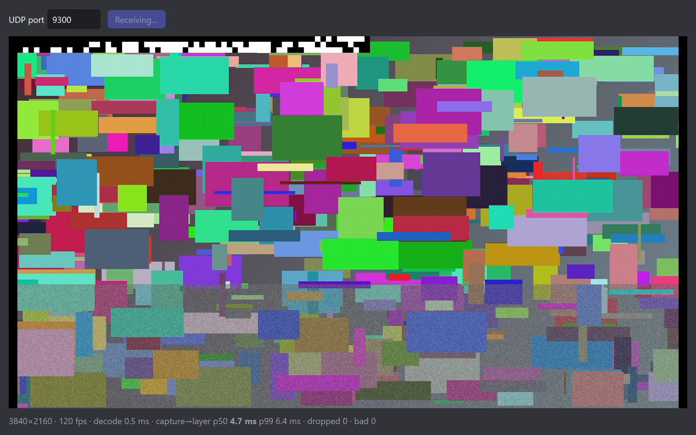

# Windows results: i7-13700K + RTX 4090

**Machine:** Intel Core i7-13700K, 64 GB RAM, NVIDIA GeForce RTX 4090 (driver 610.88, NVENC API 13.1), Windows 11 Pro
26300. Display 3840×2160 @ 240 Hz, 150 % scaling (devicePixelRatio 1.5). Desktop on mains power, "Balanced" power plan.
HEVC and AV1 decode via the Microsoft Store "HEVC Video Extensions" 2.5.48 and "AV1 Video Extension" 2.0.35.

## Summary

1. **The Tauri UI is smooth on WebView2:** 240 fps scroll/append/typing, the same as Chrome. Passes every criterion.
2. **An RTX 4090 hosts 4K120 easily.** NVENC encodes 4K in 3–4 ms (HEVC/AV1, P1), so **4K120 HEVC goes from capture to
   decoded frame in 4.0 ms (p99 6.6 ms) in loopback**, at a full 120 fps with no drops. On the M4 Pro the encoder alone
   takes ~17 ms per 4K frame and 4K120 isn't possible.
3. **The native video surface works in the Tauri window:** capture → handed to DWM in **4.4–4.7 ms p50, 5.5–6.4 ms
   p99** at 4K120 (debug build of the app), placed exactly over the UI's box, including after resizing and maximising.
4. Decode is ~0.2 ms with Media Foundation + D3D11 (DXVA) on the 4090, for every codec and resolution.

## 1. UI benchmark (#51)

10k messages, `client/ui/src/Bench.tsx`. Tauri debug build (`pnpm tauri build --debug --no-bundle`) with WebView2
(Edge 158), and Chrome 156 on the production build (`pnpm --dir ui preview`, `#bench`). Three runs each; the first
run of each is a cold start.

| Runtime | Viewport | Mount (cold / warm) | Scroll fps (p99) | Append fps | Typing→frame p50 / p95 | Hitches >25 ms (cold / warm) |
|---|---|---|---|---|---|---|
| WebView2 (Tauri) | 1280×800 | 118 ms / 43–48 ms | 240 (4.3 ms) | 240 | 4.2 / 4.3 ms | 1 / 0 |
| Chrome 156 | 1266×763 | 281 ms / 48 ms | 239 (4.3 ms) | 240 | 4.2 / 4.3 ms | 1 / 0 |

**Pass** on every criterion (scroll ≥ 55 fps, ≤ 5 hitches, mount < 100 ms warm, typing p95 < 34 ms). Unlike
WKWebView on macOS (capped near 60 Hz), WebView2 renders at the display's full 240 Hz, the same as Chrome. Only the
cold first mount (118 ms, JIT and font warm-up) is above 100 ms; Chrome's cold mount is slower still.

## 2–3. Encode → UDP → decode matrix (loopback, #49)

`examples/send.rs` (synthetic BGRA frames on the GPU → NVENC on D3D11, `ULTRA_LOW_LATENCY` tuning, no B-frames,
infinite GOP, CBR with a one-frame VBV, synchronous encode) → wire format → `examples/recv.rs` (Media Foundation
decoder MFT with a D3D11 device manager, `MF_LOW_LATENCY`, NV12 output in D3D11 textures). Run with
`python client/crates/snacka-core/run-matrix.py --seconds 8 --codecs h264,hevc,av1 --presets 1,4`.

"Encode" = capture timestamp → bitstream available (GPU copy + RGB→YUV + NVENC). "Total" = capture timestamp (in the
pixels) → decoded picture available, read back from the barcode. Same clock (QueryPerformanceCounter), same machine.
Not included: real screen capture (≤ 1 frame) and display (≤ 1 refresh; see section 4 for capture → present).

| Mode | Codec | Preset | fps sent / decoded | Encode p50/p99 ms | Decode p50/p99 ms | **Total p50**/p95/p99 ms | Mbps | Keyframes / requests | Dropped | Bad barcode |
|---|---|---|---|---|---|---|---|---|---|---|
| 1920x1080@60 | h264 | P1 | 60 / 60 | 2.6 / 4.0 | 0.2 / 0.4 | **2.9** / 3.9 / 4.4 | 6 | 1 / 0 | 0 | 0 |
| 1920x1080@60 | h264 | P4 | 60 / 60 | 3.6 / 4.1 | 0.2 / 0.3 | **3.9** / 4.2 / 4.4 | 6 | 1 / 0 | 0 | 0 |
| 1920x1080@60 | hevc | P1 | 60 / 60 | 2.7 / 3.7 | 0.2 / 0.5 | **3.2** / 3.9 / 4.2 | 12 | 1 / 0 | 0 | 0 |
| 1920x1080@60 | hevc | P4 | 60 / 60 | 4.2 / 5.1 | 0.2 / 0.3 | **4.5** / 5.0 / 5.5 | 5 | 1 / 0 | 0 | 0 |
| 1920x1080@60 | av1 | P1 | 60 / 57 | 2.2 / 3.8 | 0.2 / 0.3 | **2.5** / 3.4 / 4.2 | 8 | 1 / 0 | 0 | 0 |
| 1920x1080@60 | av1 | P4 | 60 / 58 | 3.2 / 3.8 | 0.2 / 0.4 | **3.5** / 3.9 / 4.6 | 8 | 1 / 0 | 0 | 0 |
| 1920x1080@120 | h264 | P1 | 120 / 120 | 2.6 / 3.6 | 0.2 / 0.3 | **2.9** / 3.7 / 4.0 | 12 | 1 / 0 | 0 | 0 |
| 1920x1080@120 | h264 | P4 | 120 / 120 | 3.4 / 4.1 | 0.2 / 0.3 | **3.7** / 4.2 / 4.5 | 12 | 1 / 0 | 0 | 0 |
| 1920x1080@120 | hevc | P1 | 120 / 120 | 2.0 / 3.4 | 0.2 / 0.3 | **2.4** / 3.3 / 3.9 | 18 | 1 / 0 | 0 | 0 |
| 1920x1080@120 | hevc | P4 | 120 / 120 | 3.9 / 4.9 | 0.2 / 0.3 | **4.1** / 4.7 / 5.2 | 10 | 1 / 0 | 0 | 0 |
| 1920x1080@120 | av1 | P1 | 120 / 114 | 2.1 / 3.1 | 0.2 / 0.4 | **2.4** / 3.0 / 3.4 | 15 | 1 / 0 | 0 | 0 |
| 1920x1080@120 | av1 | P4 | 120 / 117 | 3.2 / 3.9 | 0.2 / 0.3 | **3.5** / 4.0 / 4.3 | 17 | 1 / 0 | 0 | 0 |
| 2560x1440@120 | h264 | P1 | 120 / 120 | 3.5 / 4.8 | 0.2 / 0.4 | **3.8** / 4.7 / 5.7 | 16 | 1 / 0 | 0 | 0 |
| 2560x1440@120 | h264 | P4 | 120 / 120 | 4.3 / 5.0 | 0.3 / 0.4 | **4.8** / 5.4 / 5.8 | 16 | 1 / 0 | 0 | 0 |
| 2560x1440@120 | hevc | P1 | 120 / 120 | 3.4 / 4.0 | 0.2 / 0.5 | **3.9** / 4.4 / 4.7 | 33 | 1 / 0 | 0 | 0 |
| 2560x1440@120 | hevc | P4 | 120 / 120 | 5.0 / 5.9 | 0.2 / 0.5 | **5.4** / 6.0 / 6.6 | 13 | 1 / 0 | 0 | 0 |
| 2560x1440@120 | av1 | P1 | 120 / 106 | 3.3 / 4.2 | 0.2 / 0.5 | **3.8** / 4.7 / 5.6 | 31 | 1 / 0 | 0 | 0 |
| 2560x1440@120 | av1 | P4 | 120 / 110 | 4.0 / 4.5 | 0.2 / 0.5 | **4.4** / 4.9 / 5.5 | 34 | 1 / 0 | 0 | 0 |
| 3840x2160@60 | h264 | P1 | 60 / 60 | 6.4 / 8.0 | 0.2 / 0.6 | **6.8** / 8.0 / 9.8 | 12 | 1 / 0 | 0 | 0 |
| 3840x2160@60 | h264 | P4 | 60 / 60 | 8.8 / 9.2 | 0.3 / 0.6 | **9.2** / 9.8 / 10.9 | 12 | 1 / 0 | 0 | 0 |
| 3840x2160@60 | hevc | P1 | 60 / 60 | 3.9 / 5.6 | 0.3 / 0.7 | **4.5** / 6.2 / 7.8 | 16 | 1 / 0 | 0 | 0 |
| 3840x2160@60 | hevc | P4 | 60 / 60 | 7.8 / 8.5 | 0.2 / 0.8 | **8.2** / 8.9 / 10.7 | 9 | 1 / 0 | 0 | 0 |
| 3840x2160@60 | av1 | P1 | 60 / 53 | 4.2 / 5.2 | 0.3 / 0.7 | **4.9** / 5.6 / 6.7 | 30 | 1 / 0 | 0 | 0 |
| 3840x2160@60 | av1 | P4 | 60 / 54 | 5.0 / 6.8 | 0.4 / 0.7 | **6.5** / 7.7 / 8.4 | 40 | 1 / 0 | 0 | 0 |
| 3840x2160@120 | h264 | P1 | 120 / 120 | 6.0 / 7.0 | 0.3 / 0.5 | **6.5** / 7.9 / 8.6 | 23 | 1 / 0 | 0 | 0 |
| 3840x2160@120 | h264 | P4 | 103 / 104 | 9.3 / 10.0 | 0.3 / 0.6 | **9.8** / 10.7 / 11.4 | 20 | 1 / 0 | 0 | 0 |
| **3840x2160@120** | **hevc** | **P1** | **120 / 120** | **3.7 / 5.4** | 0.2 / 0.7 | **4.0** / 5.7 / 6.6 | 30 | 1 / 0 | 0 | 0 |
| 3840x2160@120 | hevc | P4 | 120 / 120 | 6.6 / 7.0 | 0.2 / 0.4 | **6.9** / 7.3 / 7.5 | 21 | 1 / 0 | 0 | 0 |
| 3840x2160@120 | av1 | P1 | 120 / 116 | 3.1 / 5.0 | 0.2 / 0.4 | **3.6** / 5.1 / 6.2 | 54 | 1 / 0 | 0 | 0 |
| 3840x2160@120 | av1 | P4 | 120 / 116 | 5.3 / 6.1 | 0.2 / 0.5 | **6.0** / 6.5 / 6.9 | 70 | 1 / 0 | 0 | 0 |

### Findings
1. **HEVC P1 is the sweet spot for remote play:** 2.4–4.5 ms capture → decoded at every tier, including 4K120.
   AV1 P1 encodes as fast or faster at 4K and is a good choice where the viewer can decode AV1.
2. **H.264 at 4K is 1.6–2× slower** than HEVC (6–9 ms) and **4K120 P4 can't keep up** (103 fps): the sender encodes
   synchronously, one frame at a time, so encode time must stay under the 8.3 ms budget. Pipelining two frames
   (NVENC async mode / two encode sessions) would remove that limit at the cost of a frame of latency; better to
   just use HEVC/AV1 or P1 at 4K120.
3. **Decode is ~0.2 ms** (DXVA through Media Foundation) at every resolution and codec, ~10× faster than VideoToolbox
   on the M4 Pro.
4. **The Media Foundation AV1 decoder holds a picture back now and then** and then returns two at once; the receiver
   keeps the newest, so 3–12 % of AV1 frames are skipped (the "decoded" fps column). H.264/HEVC never do this.
   The receiver used to ask for a keyframe each time; it now only asks when the decoder produces nothing twice in a row.
5. **Bitrates are below the CBR target** because the synthetic content is easy to compress and NVENC doesn't pad
   (no filler data). Encode time barely depends on content for NVENC; real games will use the full bitrate.

## 4. Native video surface in the Tauri window

`client/src-tauri/src/video_surface_windows.rs`: a child HWND above the WebView2 window (click-through), a DXGI
flip-model swap chain (`FLIP_DISCARD`, frame-latency waitable object, `SetMaximumFrameLatency(1)`, `Present(0)`) on
the decoder's D3D11 device, and `ID3D11VideoProcessor` for NV12 → BGRA with aspect fit (zero copies from the decoder's
texture to the back buffer). The UI's rect (CSS px) × the window DPI scale = physical px.

| Stream | fps | Decode p50 | Capture → present p50 / p99 | Dropped / bad |
|---|---|---|---|---|
| 4K120 HEVC P1, 100 Mbps, window 1920×1200 | 120 | 0.5–0.7 ms | **4.3–5.8 / 5–9 ms** | 0 / 0 |
| same, maximised (3840×2054) | 120 | 0.5–0.6 ms | **4.4–4.6 / 5.5–8 ms** | 0 / 0 |

"Present" = handed to DWM (after `Present` returns); the display adds up to one refresh (4.2 ms at 240 Hz). The first
~5 s after start show spikes (p99 up to 190 ms) while the video processor, views and swap chain are created and the
window is first shown.

Placement was verified on screenshots by reading pixels: the black box from the UI at CSS (16, 67) 1248×717 maps to
physical (24, 100) 1872×1076 at 150 % scaling, and the surface covers it exactly; after a layout change (1872×1026)
and after maximising, the surface follows and the 16:9 video is pillarboxed inside the box.

Maximised: [windows-native-surface-maximized.jpg](windows-native-surface-maximized.jpg)

Not tested yet: true fullscreen, moving between monitors with different DPI, and the cross-machine run (Mac sender →
Windows receiver, handoff step 5).
